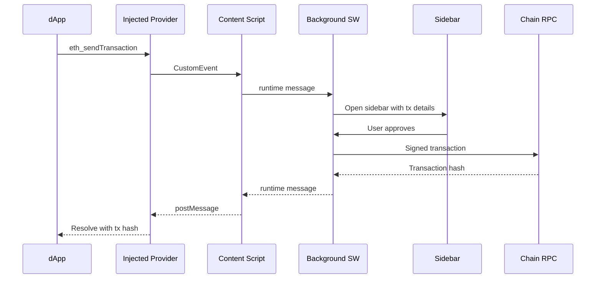

In 2024 I was the sole architect of the Arcana wallet: a non-custodial Chrome extension that supported 10+ blockchains and showed the user one balance across all of them, inside apps like Aave, Uniswap, Lido and Hyperliquid that had no idea we existed. It reached 750+ users and a 4.7-star rating on the [Chrome Web Store](https://chromewebstore.google.com/detail/arcana-wallet/nieddmedbnibfkfokcionggafcmcgkpi) during a bear market.

The code was hard. The code was also not the interesting part. Four decisions shaped the product. I would change one of them and adjust another.

## Decision 1: a sidebar, not a popup

Almost every crypto wallet is a popup: a small window that opens over the page and closes the moment you click elsewhere.

That works for "connect" and "sign in". It fails at the moment that matters. When you approve a swap, the details you need to check (token pair, price impact, slippage) are in the app, and the thing you are about to sign (value, gas, contract address) is in the wallet. With a popup you read one, memorize it, open the other and hope. With a sidebar both are on screen and you compare them directly.

Our users were DeFi power users, and that comparison is their whole day. So the sidebar was the product, decided on day one, not a feature added later.

What it cost: a less familiar pattern that needed explaining, more screen to design for, and more work to stay compatible with sites built around a popup wallet's behavior.

I would make this call again. Of the four, it is the one users noticed.

## Decision 2: MetaMask compatibility over our own API

Every app in this ecosystem is built to talk to MetaMask. A new wallet has two options. Invent a cleaner provider API and wait for apps to adopt it, which they will not. Or behave exactly like the wallet they already support, so that every existing app works on day one.

I chose the second. That meant reading MetaMask's open-source code until I understood how its provider injection works, then building a compatible implementation from scratch, covering both the older `window.ethereum` standard ([EIP-1193](https://eips.ethereum.org/EIPS/eip-1193)) and the newer multi-wallet discovery standard ([EIP-6963](https://eips.ethereum.org/EIPS/eip-6963)).

What it cost: we inherited another product's quirks as our specification. "Works like MetaMask" includes the behavior nobody documented, and you find that behavior one broken app at a time.

It was still the right trade. An elegant API with no apps is a demo. An ugly compatibility layer with every app is a wallet.

## Decision 3: ten chains at launch

We launched with 10+ chains because the narrative demanded it. "Ten chains" reads better in an announcement than "five".

In practice, 4 to 5 chains carried about 80% of user activity. Half of the launch surface served a small share of the usage. Every extra chain is another RPC provider with its own rate limits, another set of token contracts, another row in the test matrix, and another place for the unified balance to be wrong.

This is the decision I would change. Launch with five, add the rest when users ask. The number of chains was a marketing decision paid for with engineering and testing time.

## Decision 4: extracting the SDK late

The part of the wallet that mattered most was not the wallet. It was the logic underneath: treat balances on many chains as one balance, and move funds to where the transaction needs them.

That logic was later extracted into a standalone TypeScript SDK, which became the foundation of Avail's Nexus product. Three of us were invited to Dubai for two months to plan and ship it.

The extraction was harder than it needed to be, because I had not built for it. Wallet UI concerns and chain abstraction logic were tangled together, and separating them meant a real refactor.

I would build with extraction in mind from day one. That does not mean designing an SDK before a single user has touched the product, which is how you get a clean boundary in the wrong place. It means something cheaper: keep the core free of UI imports from the first commit, and defer the packaging until someone needs it.

## What could go wrong

The signature feature is also the most dangerous one.

A user on Aave, on Ethereum, has USDC spread across five chains. Aave on its own sees only the Ethereum portion. With our extension, Aave sees the total, as if all of it were on Ethereum. When the user acts on that number, the wallet bridges or swaps the difference from other chains in the background before the real transaction runs.

So the wallet is displaying, inside someone else's app, a balance on a chain where those funds are not. Everything depends on the gap between "shown" and "actually there" closing every single time.

The ways it does not close:

- **The bridge fails outright.** The user has approved something the destination chain cannot pay for.
- **The bridge lags.** Funds have left the source, have not arrived, and the user is looking at a transaction that seems stuck.
- **The balance is stale.** A price feed or an RPC returned old data, and the total was never true.
- **Part of it lands.** Enough arrived for gas, not enough for the action.

Every one of these had handling. The error copy was still the weakest part. "Insufficient funds for gas" is accurate and useless to someone who does not know they need ETH on Arbitrum before they can swap there. The general approach to flows like this is in [designing multi-step flows that survive failure](/blog/designing-multi-step-flows-that-survive-failure/).

## What I took from it

Three of the four decisions were about what the product is. Only one, the SDK, was about how the code is arranged. That ratio is typical, and it is why I now [pick the tech stack last](/blog/how-i-choose-a-tech-stack/).

The decision I would change is the one where a narrative set the scope. The one I would repeat without thinking is the one a user can see without being told.

## Appendix: the mechanics, briefly

For engineers who want the how.

**Injection takes five hops.** A page and an extension cannot talk directly, so every request from an app passes through an injected provider in the page, a content script, the background service worker, and the sidebar for approval, then all the way back. Every hop is asynchronous and every hop can fail.

**The service worker sleeps.** Under Manifest V3 the background script is terminated after about 30 seconds of inactivity. Selected account, active chain and pending approvals all have to be persisted and restored, and any request in flight when the worker dies must be retried or failed cleanly.

**Balances are intercepted at two layers.** Some apps ask the wallet provider for balances. Others call public RPC endpoints directly. We handled both, for native balances, ERC-20 `balanceOf` calls, and multicalls, where many balance queries are batched into one request. A multicall has to be decoded, each balance replaced with the unified figure, and the response re-encoded so the app cannot tell the difference.

**Fetching 100+ balances without hitting rate limits** came down to batching with viem's multicall, staggered requests, a multichain balance API later on, and a second price source with staleness checks.
